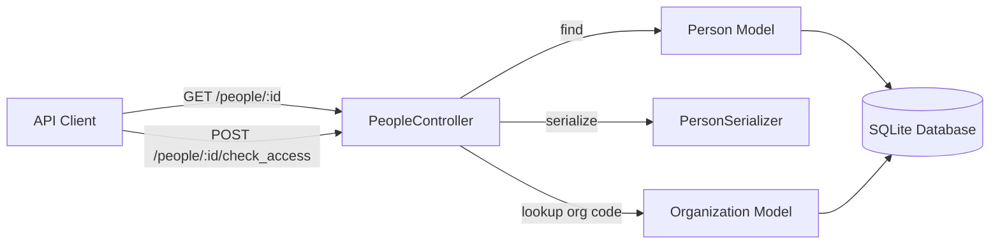

# Requirements

### Overview & Goals
The objective of this initiative is to establish a rigorous, production-grade planning suite and development blueprint for completing the Ruby on Rails technical challenge. The application provides a lightweight JSON API exposing endpoints for retrieving person records and validating access against organization codes.

### Scope
- **In Scope:**
  - Creation of 4 planning artifacts: `docs/requirements.md`, `docs/plan.md`, `docs/tasks.md`, and `.junie/guidelines.md`.
  - Specification of ActiveRecord database migrations for `Person` and `Organization` tables with strict data typing.
  - Endpoint contracts for `GET /people/:id` and `POST /people/:id/check_access` with JSON payloads and error responses.
  - JSON serialization specification using `active_model_serializers`.
  - Comprehensive TDD strategy using RSpec.
  - Docker Compose integration guide for IntelliJ IDEA / RubyMine.
- **Out of Scope:**
  - Modifying third-party gem dependencies beyond what is present in `Gemfile`.
  - Full CRUD lifecycle endpoints (only `show` and `check_access` are required).

### User Stories
- **US-1 (Person Profile Lookup):** As an API client, I want to fetch a person's profile by ID so that I can display their `first_name`, `last_name`, and `phone_number` without exposing internal permission codes or timestamps.
- **US-2 (Access Control Verification):** As a security gateway or client application, I want to query whether an active person possesses permission to access a specific organization by ID, so that authorization decisions are enforced accurately.

### Functional Requirements
- **FR-1 (Database Migrations):**
  - `people` table: `first_name` (string, not null), `last_name` (string, not null), `phone_number` (string), `active` (boolean, default: true, not null), `permission_codes` (json or text, default: `[]`), and `timestamps`.
  - `organizations` table: `name` (string, not null), `code` (string, not null, indexed), `address` (string/text), `phone_number` (string), and `timestamps`.
- **FR-2 (`GET /people/:id`):**
  - Returns HTTP `200 OK` with JSON `{ "first_name": "...", "last_name": "...", "phone_number": "..." }` when the record exists.
  - Returns HTTP `404 Not Found` with JSON `{ "error": "Person not found" }` when the record does not exist.
- **FR-3 (`POST /people/:id/check_access`):**
  - Accepts request payload `{ "organization": { "id": <org_id> } }`.
  - Returns HTTP `404 Not Found` with `{ "error": "Person not found" }` if the person ID is invalid.
  - Evaluates access as `true` if and only if `person.active == true` AND the target organization exists AND `person.permission_codes` contains `organization.code`.
  - Returns HTTP `200 OK` with JSON `{ "access": true }` or `{ "access": false }`.

### Non-Functional Requirements
- **Determinism & Performance:** Database lookups on organizations by code or ID must be index-optimized with minimal queries.
- **Maintainability & TDD:** 100% test coverage for controller request specs and model validations using RSpec.
- **Container Portability:** Seamless local execution via Docker Compose and native integration with IDE toolchains.

# Technical Design

### Current Implementation
- **Framework:** Ruby on Rails 7.1.4 on Ruby 3.3.1 running with SQLite3.
- **Routing:** `resources :people, only: :show` with member action `post 'check_access'` in `config/routes.rb`.
- **Controller:** Skeleton `PeopleController` with unauthenticated actions and CSRF skipped for JSON API requests.
- **Models:** Empty ActiveRecord models `Person` and `Organization`.
- **Gems Available:** `active_model_serializers`, `rspec-rails`, `faker`.

### Key Decisions
1. **Serialization Layer:** Use `ActiveModelSerializers` via dedicated `PersonSerializer` (`app/serializers/person_serializer.rb`) to isolate data presentation from model logic.
2. **Permission Codes Storage:** Use `t.json :permission_codes, default: []` in the migration, with Active Record array serialization fallback (`serialize :permission_codes, coder: JSON`) for clean array operations in Ruby and SQLite.
3. **Error Handling Architecture:** Utilize Rails standard controller exception handling (`rescue_from ActiveRecord::RecordNotFound`) or explicit guard clauses returning standard JSON error envelopes with proper HTTP status codes.
4. **IDE Tooling:** Use IntelliJ IDEA / RubyMine Docker Compose Remote Ruby Interpreter to execute tests and debugger sessions directly in the containerized environment.

### Architecture Diagram


### Proposed Schema Design

#### Initial Table Setup Migrations
- `db/migrate/20250924140936_create_people.rb`
```ruby
class CreatePeople < ActiveRecord::Migration[7.1]
  def change
    create_table :people do |t|

      t.timestamps
    end
  end
end
```

- `db/migrate/20250924141004_create_organizations.rb`
```ruby
class CreateOrganizations < ActiveRecord::Migration[7.1]
  def change
    create_table :organizations do |t|

      t.timestamps
    end
  end
end
```

#### Additive Attribute Migrations
- `db/migrate/20260930100001_add_attributes_to_people.rb`
```ruby
class AddAttributesToPeople < ActiveRecord::Migration[7.1]
  def change
    add_column :people, :first_name, :text, null: false
    add_column :people, :last_name, :text, null: false
    add_column :people, :phone_number, :text
    add_column :people, :active, :boolean, default: true, null: false
    add_column :people, :permission_codes, :json, default: []
  end
end
```

- `db/migrate/20260930100002_add_attributes_to_organizations.rb`
```ruby
class AddAttributesToOrganizations < ActiveRecord::Migration[7.1]
  def change
    add_column :organizations, :name, :text, null: false
    add_column :organizations, :code, :text, null: false
    add_column :organizations, :address, :text
    add_column :organizations, :phone_number, :text
    add_index :organizations, :code
  end
end
```

### Controller & Serializer Architecture
- **Serializer:** `app/serializers/person_serializer.rb`
  ```ruby
  class PersonSerializer < ActiveModel::Serializer
    attributes :first_name, :last_name, :phone_number
  end
  ```
- **Access Check Logic:**
  ```ruby
  def check_access
    person = Person.find(params[:id])
    org_id = params.dig(:organization, :id)
    org = Organization.find_by(id: org_id)

    has_access = person.active? && org.present? && Array(person.permission_codes).map(&:to_s).include?(org.code.to_s)
    render json: { access: has_access }, status: :ok
  rescue ActiveRecord::RecordNotFound
    render json: { error: "Person not found" }, status: :not_found
  end
  ```

### IntelliJ IDEA / RubyMine Docker Integration Guide
1. **Prerequisites:** Enable the **Docker** plugin and **Ruby** plugin in IntelliJ IDEA Ultimate / RubyMine.
2. **Configure Docker Connection:**
   - Go to `Settings / Preferences -> Build, Execution, Deployment -> Docker`.
   - Add a Docker daemon connection (Unix socket `unix:///var/run/docker.sock` on Linux/macOS or Docker Desktop pipe on Windows).
3. **Configure Remote Ruby SDK via Docker Compose:**
   - Go to `Settings / Preferences -> Languages & Frameworks -> Ruby SDK and Gems`.
   - Click `+` -> `New remote...`.
   - Select **Docker Compose**, pick configuration file `docker-compose.yml` and service `web`.
   - IntelliJ automatically inspects the container, detects Ruby 3.3.1 and bundled gems.
4. **Configure RSpec Run Configuration:**
   - Go to `Run -> Edit Configurations...`.
   - Create a new **RSpec** template or run configuration.
   - Set SDK to the newly created Remote Docker Compose SDK.
   - Now clicking the green "Run" or "Debug" gutter icons on any `spec` file will execute `bundle exec rspec` inside the `web` container.

# Artifacts Specification

### Artifact Structure & Content Specifications

#### 1. `docs/requirements.md`
- **Document Metadata:** Title, status, version, and challenge overview.
- **Data Dictionary:** Field names, data types, constraints, nullability, defaults, and business rules for `people` and `organizations`.
- **API Endpoint Specifications:**
  - Endpoint path, HTTP verb, URL parameters, request body schemas, and response body schemas.
  - Exhaustive status code matrices (200, 404, 422).
- **Access Control Matrix:** Truth table for `person.active`, `organization.exists`, and `permission_codes` intersection.

#### 2. `docs/plan.md`
- **System Architecture:** Layered Rails MVC pattern, ActiveModel Serializers integration, and routing structure.
- **Database & Migration Strategy:** Type selections, JSON columns, indices, and migration execution steps (`docker compose exec web bin/rails db:migrate`).
- **IntelliJ IDEA / Docker Development Workflow:** Step-by-step instructions for Remote Ruby SDK, running tests inside containers, viewing logs in IntelliJ Services tool window, and debugging with breakpoints.
- **Risk Management & Mitigations:** SQLite JSON column type edge cases, string vs integer permission code comparisons, and nil safety.

#### 3. `docs/tasks.md`
- **Task Progression Breakdown:**
  - Task 1: Complete and apply database migrations (`db/migrate/*`).
  - Task 2: Implement model validations and array serialization for `permission_codes`.
  - Task 3: Create `PersonSerializer` to whitelist `first_name`, `last_name`, `phone_number`.
  - Task 4: Implement `GET /people/:id` endpoint with 200 and 404 responses.
  - Task 5: Implement `POST /people/:id/check_access` endpoint with full matrix handling.
  - Task 6: Fill in RSpec request test suite in `spec/requests/people_controller_request_spec.rb`.
  - Task 7: Add database seeds in `db/seeds.rb` and execute end-to-end sanity verification.
- **Git Commit Map:** Specific commit messages for each task adhering to conventional commits (e.g., `feat(db): create people and organizations tables`).

#### 4. `.junie/guidelines.md`
- **TDD Workflow Policy:** Strict Red-Green-Refactor sequence. Write the failing RSpec scenario first, implement minimal code to pass, then refactor.
- **Code Style & Standards:** Ruby 3.3 frozen string literals, RuboCop conventions, Strong Parameters, early returns.
- **Container Command Reference:** Cheat sheet for `docker compose up`, `docker compose exec`, `docker compose run --rm web bundle exec rspec`, and `docker compose down -v`.

# Testing & Quality Assurance

### Validation Approach
Verification follows a strict Test Driven Development (TDD) harness using RSpec request specifications executed directly in the Docker container.

### Key Test Scenarios (`spec/requests/people_controller_request_spec.rb`)
1. **Scenario 1: `GET /people/:id` (Success)**
   - Create an active person with first name, last name, phone number, and permission codes.
   - Perform `get "/people/#{person.id}"`.
   - Assert `response.status == 200`.
   - Assert JSON body equals `{ "first_name": person.first_name, "last_name": person.last_name, "phone_number": person.phone_number }`.
   - Assert `permission_codes`, `active`, `id`, `created_at`, and `updated_at` are excluded.
2. **Scenario 2: `GET /people/:id` (Not Found)**
   - Perform `get "/people/999999"`.
   - Assert `response.status == 404`.
   - Assert JSON body equals `{ "error": "Person not found" }`.
3. **Scenario 3: `POST /people/:id/check_access` (Person Not Found)**
   - Perform `post "/people/999999/check_access", params: { organization: { id: org.id } }`.
   - Assert `response.status == 404`.
   - Assert JSON body equals `{ "error": "Person not found" }`.
4. **Scenario 4: `POST /people/:id/check_access` (Person Inactive)**
   - Create inactive person (`active: false`) holding organization's permission code `['123']`.
   - Perform `post "/people/#{person.id}/check_access", params: { organization: { id: org.id } }`.
   - Assert `response.status == 200`.
   - Assert JSON body equals `{ "access": false }`.
5. **Scenario 5: `POST /people/:id/check_access` (Active Person, No Code Match)**
   - Create active person with codes `['999']`, organization with code `'123'`.
   - Perform check_access request.
   - Assert `response.status == 200`.
   - Assert JSON body equals `{ "access": false }`.
6. **Scenario 6: `POST /people/:id/check_access` (Active Person, Code Matches)**
   - Create active person with codes `['123', '456']`, organization with code `'123'`.
   - Perform check_access request.
   - Assert `response.status == 200`.
   - Assert JSON body equals `{ "access": true }`.

### Edge Cases to Validate
- Target organization ID in payload does not exist in the database -> returns `{ "access": false }` with status 200.
- Malformed payload or missing `organization` param -> safe handling returning `{ "access": false }`.
- Permission codes containing mixed types (e.g. integer `123` vs string `"123"`) -> string normalization ensures matching works reliably.

### Test Execution Command
```bash
docker compose run --rm web bundle exec rspec spec/requests/people_controller_request_spec.rb
```

# Delivery Steps

### ✓ Step 1: Generate Guidelines and Requirements Artifacts
Generate the project foundational guidelines and functional requirements documents.

- Create `.junie/guidelines.md` capturing development best practices, TDD rules (Red-Green-Refactor cycles), commit standards, and Rails/RSpec conventions.
- Create `docs/requirements.md` detailing the complete functional and non-functional specifications, endpoint contracts (`GET /people/:id`, `POST /people/:id/check_access`), schema specifications, status codes, and user stories.

### ✓ Step 2: Generate Technical Plan & IntelliJ Docker Integration Guide
Generate the comprehensive implementation design and IntelliJ Docker integration documentation.

- Create `docs/plan.md` defining the architectural structure, schema design (ActiveRecord SQLite column types, JSON permission codes), controller patterns, `ActiveModel::Serializer` usage, and error handling.
- Include an in-depth IntelliJ IDEA / RubyMine Docker Compose integration section covering Remote Ruby Interpreter setup, running RSpec configurations inside containers, and debugging workflows.

### ✓ Step 3: Generate Incremental TDD Task Breakdown & Commit Strategy
Generate the incremental task breakdown and verification runbook.

- Create `docs/tasks.md` structured as discrete, test-driven phases with explicit Red-Green-Refactor checkpoints.
- Map each unit of work to a single repository commit and define precise Docker test execution commands (`docker compose run --rm web bundle exec rspec`) for developer approval.